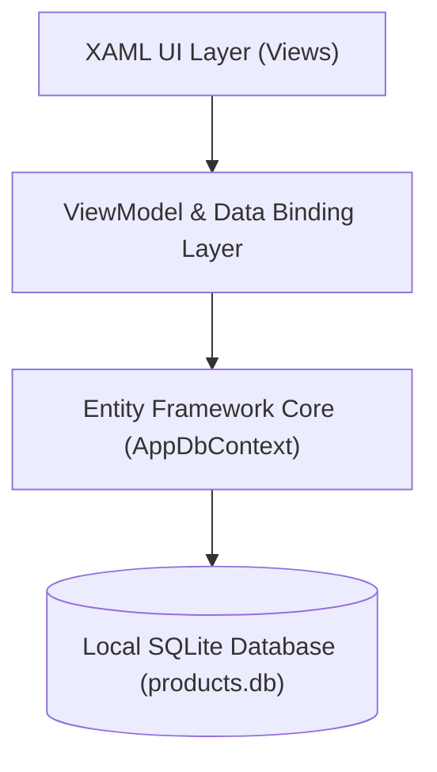

# ManagerProduct - Mobile Inventory & Sales Management Application

ManagerProduct is a cross-platform mobile application built with .NET 8 MAUI and SQLite (via Entity Framework Core 9). The application serves internal retail and warehouse workflows, enabling offline-first catalog management, customer records, inventory synchronization, and order processing.

---

## Technical Stack

- Framework: .NET 8 MAUI (Multi-platform App UI)
- Language: C# 12
- Local Storage: SQLite embedded database via Entity Framework Core 9
- Architecture: MVVM (Model-View-ViewModel) with CommunityToolkit.Mvvm
- Platforms: Android (Target API 34+), Windows, iOS, MacCatalyst

---

## Key Modules and Capabilities

### 1. Dashboard & Statistics
- Real-time aggregation of inventory levels, out-of-stock items, total registered customers, and historical sales revenue.
- Rapid navigation shortcuts to core operational modules.

### 2. Product & Inventory Management
- Real-time catalog search filtering by product name and category.
- Full CRUD operations: Create, read, update, and delete product listings with instant collection refresh.
- Inventory quantity tracking with out-of-stock indicators.

### 3. Customer Directory
- Centralized customer profiles including contact details, addresses, and birth dates.
- Interactive phone and email integration for customer communication.
- Instant search by customer name or phone number.

### 4. Order Processing & Invoicing
- Multi-item checkout workflow with quantity selection and customer binding.
- Inventory validation preventing checkout when quantities exceed available stock.
- Automatic inventory decrement upon order confirmation.
- Historical invoice ledger with drill-down detailed itemized breakdown and currency formatting.

---

## System Architecture



---

## Prerequisites

- .NET 8 SDK
- Visual Studio 2022 (version 17.8 or later) with the ".NET Multi-platform App UI development" workload installed
- Android SDK (API Level 21 or higher) or an active Android emulator

---

## Building and Running

1. Clone the repository:
   ```bash
   git clone git@github.com:cuongnd-code/ManagerProduct.git
   cd ManagerProduct
   ```

2. Restore dependencies:
   ```bash
   dotnet restore ManagerProduct.csproj
   ```

3. Build the project:
   ```bash
   dotnet build ManagerProduct.csproj -f net8.0-android
   ```

4. Run on an Android emulator or connected device:
   ```bash
   dotnet build ManagerProduct.csproj -t:Run -f net8.0-android
   ```
